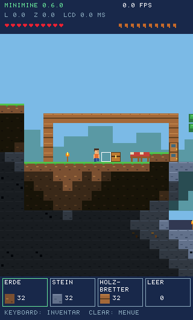
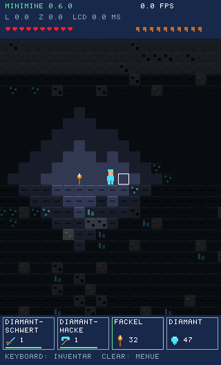
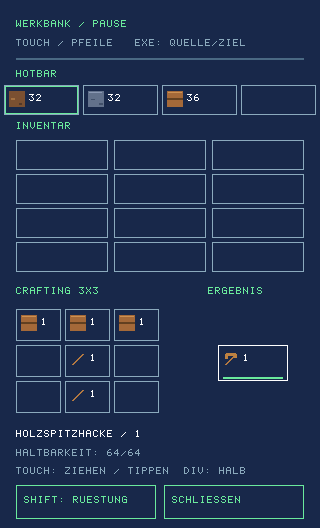

# Minimine

A small 2D block game for the Casio ClassPad II fx-CP400 with Hollyhock 3.
Craft, build a base, explore dark caves and treasure chests, and face the Stone Guardian.
Make diamond equipment and find three relics to unlock its chamber.

[Download version 0.6.0](releases/0.6.0/CasioSandbox.hh3).
Copy the `.hh3` file to your CP400 and start it from the launcher.
The game creates the `/Minimine` folder when you save for the first time.

  
  
  

Base building, deep caves and crafting — game graphics from version 0.6.0.

| Control | Action |
| --- | --- |
| Left / right | Move and aim |
| Up / SHIFT | Jump |
| Down | Toggle sneak |
| X / Y / Z / ^ | Select hotbar slot 1 / 2 / 3 / 4; in the inventory, move its stack to the selected slot |
| Touch the hotbar | Select a slot |
| Keyboard | Open / close the inventory |
| Hold DEL | Mine |
| EXE | Attack, eat, build or use the targeted block |
| 1 / 4 / 7 and 3 / 6 / 9 | Aim left / right at foot level, eye level or above your head |
| 2 / 8 | Aim below your feet / above your head |
| SHIFT in the inventory | Armor and two accessory slots |
| Touch in the inventory | Drag a stack, or tap its source and then its destination |
| Hold DIV + touch | Move half a stack |
| 5 in the inventory | Move one item from the marked source |
| CLEAR | Pause, save, load, difficulty, help and quit |
| 0 | Benchmark |

To build a pillar beneath yourself, aim down with **2**, jump and press **EXE** to place a block below you.

Regular mobs can be pushed and remain within melee reach.
Diamonds are added to deep basalt once, including in existing worlds.
Choose Easy, Medium or Hard when starting a game or from the pause menu.

Materials stack up to 64 per slot. Tools and armor occupy one slot each and have durability.
Saving is manual. Quitting exits immediately, without confirmation or saving.
You keep your inventory and equipment when you die.

Build: `tools/build.ps1`. Tests: `tools/test.ps1`.

Renderer comparisons with CSV logs: [Minimine Bench](bench/README.md).
Version 0.6.0 retains scanline lighting. Older saves remain loadable;
new saves use format 3.

[Guide](docs/ANLEITUNG.md) · [Toolchain](docs/TOOLCHAIN.md) ·
[Benchmark](docs/BENCHMARK.md) · [Verification](docs/VERIFICATION.md)
